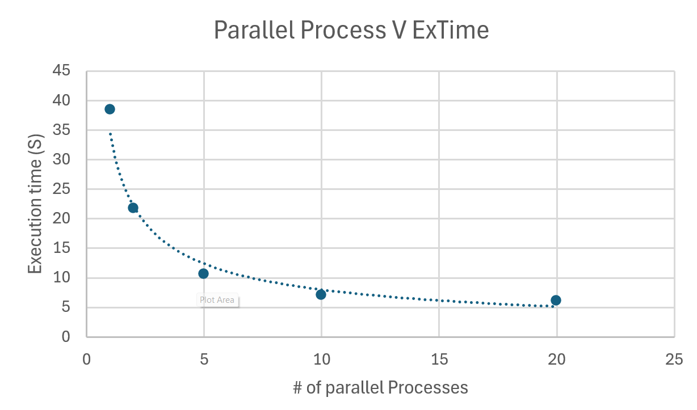

# Lab11_Multipro

### Author
- Matthew Schiemann
### Date
- 11/19/2026

## Overview
- The purpose of `mandelmovie` is to generate 50 frames of a zoom into the Mandelbrot set by using multiple processes. For each frame, the parent forks a child process, which uses `execl()` to run the `./mandel` program with that frame's scale, its limit, and the output file name (`mandel%d`). The scale shrinks by a constant ratio each frame so the zoom looks smooth and not choppy.

- The number of child processes running at once is set with the `-p` flag. When that many children are running, the parent calls `wait()` for one to finish before starting the next frame. At the end, it waits for all remaining children before exiting. The frames are then combined into a movie with ffmpeg

#### `ffmpeg -i mandel%d.jpg mandel.mpg`
#### `ffmpeg -framerate 10 -i mandel%d.jpg -r 25 mandel.mpg`   
-  50 frames ÷ 10 = 5 seconds

## Time Complexity
### Law of diminishing returns

## Discussion
- Using more processes makes a large difference at first. Going from 1 to 2 processes cut the runtime almost in half (1.8x faster), and 5 processes brought it to 3.6x faster. With each frame being calculated independently, and the work is almost all cpu computes, so seperate processes can run on seperate cores at the same time and don't need to share data. 
- The gains got smaller as more processes were added. Going from 10 to 20 proceesses saved only about 1 second, and the best result was about 6.2x faster than one process, not 20x. This comes from a couple reasons:
    - My laptop only has 14 cores. Once every one is busy, the rest must wait and take turns. 
    - The deeper zoom frames use more iterations than the early ones, so they take a bit longer. With many processes, the run can't finish until the slowest frames are done. 
    - There is still "admin overhead" to call each. Each needs a fork and exec. And each needs to be written.

- More processes do not always mean a proportional speedup. 
